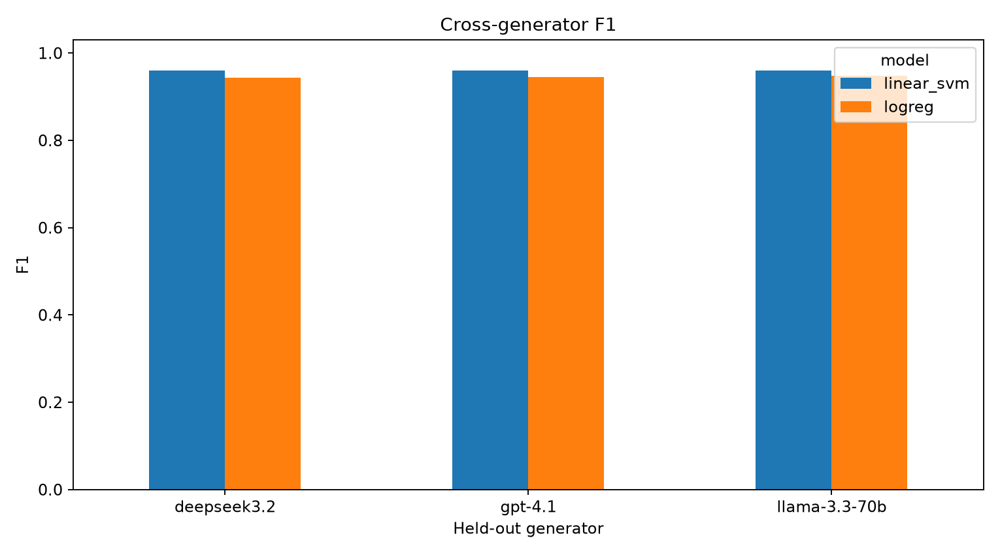
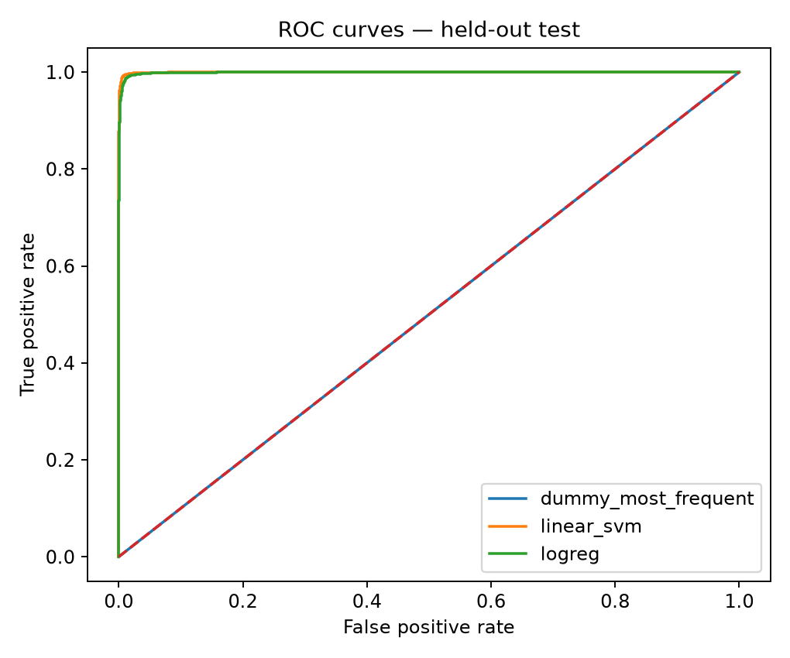

# Phishing Email Detection under Cross-Generator Shift

Detecting phishing emails with classical NLP models, and testing how well those detectors hold up against phishing written by **large language models they never saw during training** (GPT-4.1, DeepSeek 3.2, LLaMA 3.3 70B).

## Highlights

- **94,961 unique emails** merged from three public corpora (human-written and LLM-generated).
- Exact deduplication with **SHA-256** hashing of normalized text (408 duplicates removed) to prevent train/test leakage.
- Stratified **70 / 15 / 15** train / validation / test split, fixed seed (42).
- **TF-IDF (1–2 grams)** features with **Logistic Regression** and **Linear SVM**, compared against a dummy baseline.
- **Leave-one-generator-out** evaluation to measure robustness to unseen LLMs.
- Error, subgroup and calibration analysis, plus a **Streamlit** interface for testing emails.

## Results

### In-distribution test set (14,245 emails)

| Model | Accuracy | F1 | ROC-AUC | MCC |
|---|---|---|---|---|
| Dummy (most frequent) | 0.569 | 0.725 | 0.500 | 0.000 |
| Logistic Regression | 0.988 | 0.990 | 0.999 | 0.976 |
| **Linear SVM** | **0.992** | **0.993** | **1.000** | **0.985** |

### Unseen LLM generator (phishing from one LLM held out of training)

| Model | GPT-4.1 | DeepSeek 3.2 | LLaMA 3.3 70B | Relative F1 drop |
|---|---|---|---|---|
| Logistic Regression | 0.945 | 0.943 | 0.947 | 4.3–4.7% |
| **Linear SVM** | **0.959** | **0.960** | **0.960** | **≈3.4%** |

Recall on unseen-LLM phishing stays at ~1.00; the drop comes from **precision** (more false alarms on legitimate mail), which points to calibration as the main area for improvement.

<p align="center">
  
  
</p>

## Project structure

```
├── app.py                 Streamlit interface (single email, .txt/.eml upload, batch CSV)
├── config.yaml            Experiment configuration
├── bootstrap_everything.py  One-step setup: install, download data, build dataset, train
├── src/
│   ├── build_master_dataset.py   Merge sources, normalize, deduplicate (SHA-256)
│   ├── train_baselines.py        Dummy / Logistic Regression / Linear SVM
│   ├── evaluate_cross_generator.py  Leave-one-generator-out evaluation
│   ├── error_analysis.py         Error, subgroup and calibration analysis
│   ├── train_distilbert.py       Optional DistilBERT fine-tuning
│   └── inference.py              Prediction helpers used by the app
├── notebooks/             Step-by-step notebooks
├── docs/                  Data dictionary, literature matrix
├── data/                  Download instructions (data not committed)
└── results/               Figures and metric tables
```

## How to run (Windows)

```bat
setup_env.bat              :: create .venv and install requirements
DOWNLOAD_ALL_DATA_ONLY.bat :: download datasets and build master_dataset.csv
run_baselines.bat          :: train and evaluate models
run_interface.bat          :: open the Streamlit app at http://localhost:8501
```

Or run everything at once with `ONE_CLICK_FULL_SETUP_AND_TRAIN.bat`.

## Scope and limitations

- Implemented research question: how well do text-based detectors trained on a large heterogeneous corpus generalize to phishing from an **unseen LLM generator**?
- The available data has no writing-register labels, so adversarial **register shift** is not evaluated.
- DistilBERT fine-tuning code is included but optional; the reported results are from the classical models.

## Tech stack

Python · pandas · scikit-learn · matplotlib · Streamlit · (optional) Hugging Face Transformers / PyTorch

---
Nourah Aldosari — M.Sc. Artificial Intelligence, Prince Sattam Bin Abdulaziz University
